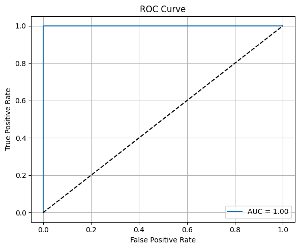
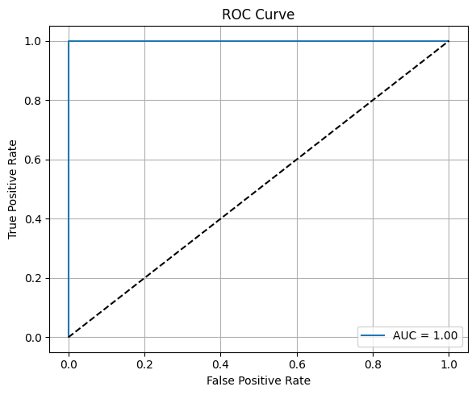
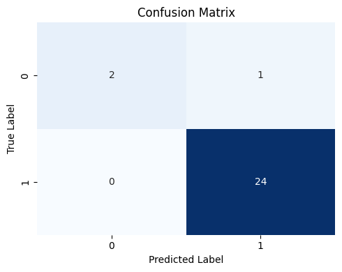
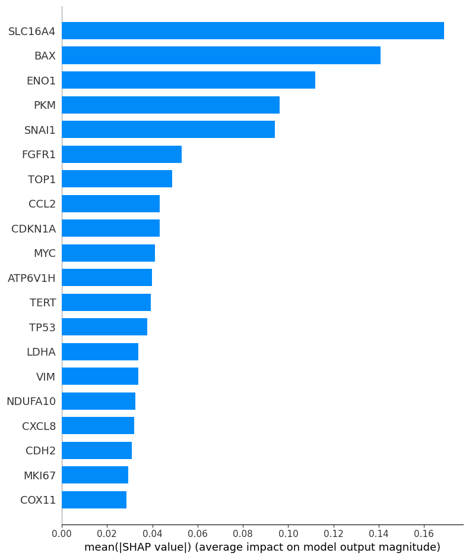
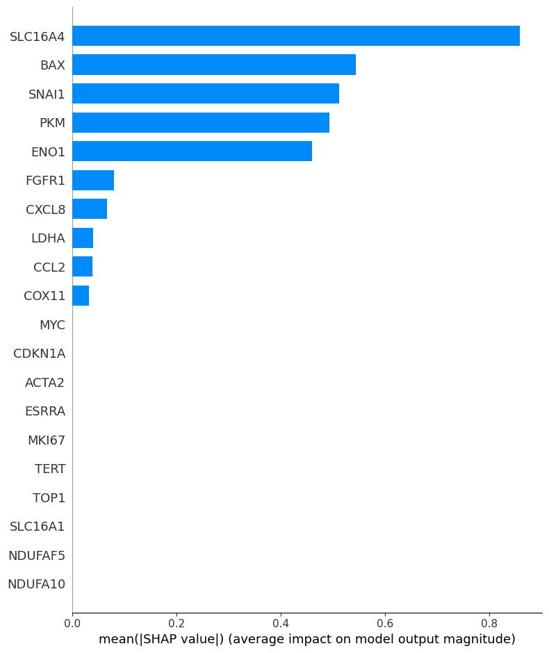

# Gene-Panel Diagnostic Classifier

Binary classification of transcriptomic samples using a curated **29-gene panel** covering EMT, apoptosis, glycolysis/OXPHOS, lactate transport, proliferation and inflammation. Two gradient-boosting models (**CatBoost** and **XGBoost**) are tuned with Bayesian optimisation and interpreted with **SHAP**.

## Pipeline

1. **Load and align**: expression matrix (samples × genes) and labels are matched on normalised sample IDs.
2. **Feature selection**: the expression matrix is restricted to the predefined gene panel. Genes are chosen from prior knowledge, not from the data.
3. **Split**: stratified 70/30 train/test split. One sample can optionally be forced into the training set.
4. **Tune**: `BayesSearchCV` with 5-fold CV and ROC-AUC scoring, run on the training set only.
5. **Evaluate**: classification report, ROC, precision-recall curve and confusion matrix on the held-out test set, plus 5-fold CV AUC.
6. **Explain**: SHAP mean |value| ranking on the training set.
7. **Export**: per-sample predictions, saved models, gene-importance tables and a run summary.

### Gene panel

| Module | Genes |
|---|---|
| EMT | CDH1, CDH2, SNAI1, SNAI2, VIM, ACTA2 |
| Apoptosis / p53 | TP53, BAX, BCL2, CASP3, CDKN1A |
| Mitochondrial / OXPHOS | COX11, ATP6V1H, NDUFAF5, NDUFA10, ESRRA |
| Glycolysis | PKM, TPI1, LDHA, ENO1 |
| Lactate transport | SLC16A1, SLC16A4 |
| Proliferation | MKI67, TERT, TOP1, MYC |
| Signalling / inflammation | FGFR1, CCL2, CXCL8 |

## Results

The dataset has 91 samples (10 class-0, 81 class-1). The test set has 27 samples: 3 class-0 and 24 class-1.

| Model | Test AUC | Class-0 recall | Class-1 recall | 5-fold CV AUC |
|---|---|---|---|---|
| CatBoost | 1.000 | 0.67 (2/3) | 1.00 | 0.994 ± 0.013 |
| XGBoost  | 1.000 | 0.67 (2/3) | 1.00 | 0.981 ± 0.025 |

**Top genes, consistent across both models:** SLC16A4, BAX, ENO1, PKM and SNAI1. These combine lactate transport, glycolysis, apoptosis and EMT.

| | CatBoost | XGBoost |
|---|---|---|
| ROC |  |  |
| Confusion |  |  |
| SHAP |  |  |

Exploratory: [class distribution](results/figures/class_distribution.png) · [PCA variance](results/figures/pca_variance.png)

## Limitations

- **Severe class imbalance (10 vs 81).** The test set has only 3 minority samples, so a single misclassification moves class-0 recall by 33 points. Treat the AUC = 1.0 as an optimistic estimate rather than a stable performance figure.
- **Small sample size.** With n = 91, the CV folds hold about 2 minority samples each, so CV AUC has high variance.
- **Hyperparameters were tuned on the training split, then cross-validated on the full dataset.** This CV estimate is mildly optimistic. Nested CV would give an unbiased estimate.
- **Forced training sample.** The reported run fixed one sample in the training set (`--sample-to-train`). This changes the split. Report results with and without it.
- **No external validation cohort.** Predictions in `*_predictions.csv` include the training samples.
- No class weighting or threshold tuning has been applied yet. `scale_pos_weight` or `auto_class_weights="Balanced"` are natural next steps.

## Usage

```bash
git clone https://github.com/<your-username>/gene-panel-diagnostic-classifier.git
cd gene-panel-diagnostic-classifier
pip install -r requirements.txt

# put expression_matrix.csv and labels.csv in data/ (see data/README.md)
python src/diagnostic_model.py \
    --expression data/expression_matrix.csv \
    --labels data/labels.csv \
    --outdir results \
    --n-iter 60
```

| Flag | Default | Meaning |
|---|---|---|
| `--models` | `catboost xgboost` | Which models to run |
| `--n-iter` | 60 | Bayesian search iterations |
| `--no-tune` | off | Skip tuning and use default hyperparameters |
| `--n-jobs` | -1 | Parallel workers for the search. Use `1` if workers crash. |
| `--sample-to-train` | none | Force a sample ID into the training set |
| `--seed` | 42 | Random seed |

The original Colab analysis, with its outputs, is in [`notebooks/diagnostic_model.ipynb`](notebooks/diagnostic_model.ipynb).

## Repository layout

```
├── src/diagnostic_model.py     # reusable pipeline (CLI)
├── notebooks/                  # original Colab notebook with outputs
├── results/figures/            # figures from the reported run
├── data/                       # input data (not tracked)
└── requirements.txt
```

## License

MIT
